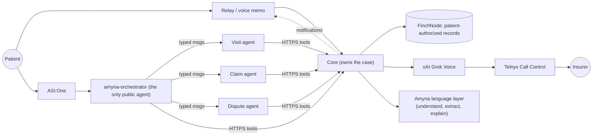

# Amyna

**Amyna helps ordinary people fight confusing medical bills.** A patient says — in
plain English or a voice memo — *"I think this hospital bill is wrong."* Amyna does
the rest: it reads the bill, compares it against the patient's own authorized
health records and visit evidence, finds charges that don't match, explains
everything in plain language, and — only after the patient explicitly approves —
calls the insurance company for them, handing the call to a human the moment the
insurer asks for anything sensitive (SSN, PIN, password, MFA code, card or bank
details).

Amyna is deliberately built so someone with **no idea what a claim number, payer,
member ID or CPT code is** can use it.

## Status (read this first)

* **Runs end to end today in fully-mocked mode with zero credentials**
  (`make test`, `make smoke`). Synthetic demo data only.
* **Live adapters for xAI Grok Voice, Telnyx and FinchNode are implemented** and
  guarded by fail-closed startup config, but have **not** been verified against the
  real vendor APIs. Staging/production refuse to boot on mock adapters.
* **Not HIPAA-ready. Do not point real patients or real PHI at this yet.** See
  [docs/SECURITY.md](docs/SECURITY.md) and [docs/DEPLOYMENT.md](docs/DEPLOYMENT.md).

## Why Amyna, in one diagram



* **Core owns the case** — it is the single source of truth: state machine with
  guards, consent, audit trail, the tools, and every telephony action.
* The **orchestrator** is the only public Fetch/Agentverse agent. The Visit, Claim
  and Dispute agents are **internal** and never published.
* The **agents do no private work directly** — they call Core's scoped
  `/internal/tools/*`; `get_patient_context` is the only door to patient identity,
  and Core is where authorization is decided.
* The **language layer** (`assistant_service.py` + the `/assistant/*` endpoints)
  understands plain language and insurance terms over stateless HTTP. It proposes
  candidates, never conclusions: every extracted identifier is a candidate the
  deterministic backend verifies before acting.
* **Cases belong to authenticated users.** Relay forwards a patient session
  token on every patient call; a typed `fn_pat_...` is an identifier, never a
  credential, and an Agentverse sender address is never proof of identity.
* On an insurer call, Amyna runs a **first-class human-merge state**:
  `sensitive_request_detected → patient_being_connected → patient_connected →
  patient_handling_verification → patient_released → ai_resuming`, with
  `merge_failed` whenever the patient cannot be reached.

## The patient experience

1. "I got this bill and I don't think it's right." → Amyna asks for a photo/PDF
   of the bill or just what happened — not for a claim number.
2. Amyna extracts provider, amount, claim number and line items, then shows a
   plain-English confirmation ("I found a bill from Memorial Hospital for
   $842.60 — is this the one?").
3. With your consent, Amyna reads your FinchNode records and checks each charge
   against your visit recording/transcript and its billing knowledge.
4. Anything it can't prove, it asks about once, simply ("Was there a second MRI,
   or just one?").
5. Amyna drafts a dispute and tells you exactly what it plans to say: "I can ask
   your insurer to review these charges — shall I?"
6. **Only after you approve does it call.** If the insurer asks for anything
   sensitive, Amyna stops speaking, dials you into the same live call, and waits:
   you — a real person — do the verification directly. Amyna never stores the
   secret.

Details, diagrams and the decision log: [docs/ARCHITECTURE.md](docs/ARCHITECTURE.md).
## Quick start

Requires Python 3.11+ (3.11–3.13) and Node 20+. Docker is optional.

```bash
make setup        # .venv + editable installs, npm install, .env from .env.example (all mock)
make test         # Python (shared, core, intelligence, finchnode, fetch) + Node tests
make smoke        # full mock E2E through the real Core HTTP API (what CI runs)
make dev-local    # Core on http://localhost:8080/docs (SQLite, Alembic-migrated)
make seed         # synthetic demo patient with a recorded, transcribed visit
make chat         # the ASI:One conversation, offline (LOCAL_DIRECT agents)
make relay-demo   # the Relay patient conversation (mock Relay adapter)
```

`make dev` runs Core + Postgres with docker compose. `make help` lists every target.

## Repository map

| Path | What it is |
|---|---|
| `core/` | FastAPI Core: DB (SQLAlchemy 2 + Alembic), state machine, auth, audit, tools, adapters, voice call manager, Amyna language layer |
| `shared/` | Contracts: Pydantic models, HTTP + tool schemas, uAgents messages, OpenAPI, generated TS |
| `relay/` | Relay patient-experience service (Node/TS) |
| `deploy/` | Production compose stack, backups, job worker docs |
| `fetch/` | uAgents orchestrator + internal specialists, pure logic, `local_direct` runner, Agentverse docs |
| `finchnode/` | FinchNode client (mock / demo / sandbox / production), normalization, tools |
| `intelligence/` | Extraction (rules / Qwen3 via Ollama), code resolver, hospital prices, policy RAG, discrepancy engine |
| `scripts/` | smoke E2E, OpenAPI export, TS codegen, seed, branch setup |
| `docs/` | Architecture, contracts, state machine, security, deployment/keys, VERIFY list |

## Safety model (rules that live in code, not prompts)

* **No call without an APPROVED dispute and stored patient authorization.** The
  state machine and payer-phone allowlist enforce this before any dial.
* **Sensitive requests pause the AI and connect a human.** SSN/PIN/password/MFA/
  DOB-auth/card/bank requests are detected in code (`security_policy.py`), AI
  output pauses, and the human merge dials the patient into the same live call.
  Duplicate requests are idempotent (one human leg). Amyna never stores secrets.
* **The voice agent can only state facts grounded in the case.** Code guardrails
  block invented codes, amounts, dates or medical terms.
* **The language layer is not an auth or identity authority.** It proposes
  candidates (with `needs_confirmation: true`); it cannot search other patients,
  grant consent, access records, submit a dispute, or dial.
* **PHI-redacting logs + an append-only audit trail** for every tool call,
  transition, consent, decision and call event.
* **Signed webhooks** (HMAC for Relay events, Ed25519 for Telnyx) with replay
  protection and idempotency.

## Environments and going live

Four strictness tiers, enforced at startup (see [docs/DEPLOYMENT.md](docs/DEPLOYMENT.md)):

| Environment | Runs on | Integrations |
|---|---|---|
| `local` | developer machine / SQLite | mock adapters allowed |
| `test` | CI | mock adapters only |
| `staging` | persistent services + Postgres | real sandbox FinchNode, test telephony, live adapters |
| `production` | persistent services + Postgres | live adapters; **fail-closed** (no mock fallback, no disabled webhook verification, no tunnels) |

Every integration has a `*_MODE` flag. Flipping one without its keys fails startup
with a message naming the missing variable. Copy the right template:
`.env.example` (local/mock), `.env.staging.example`, `.env.production.example`
— none of them contains a real secret.

### Key configuration

See [docs/SETUP_KEYS.md](docs/SETUP_KEYS.md) for the full list. The main ones:
`FINCHNODE_MODE` (`mock|demo|sandbox|production`), `EXTRACTION_MODE` (`rules|ollama`),
`FETCH_MODE` (`local_direct|agentverse`), `RELAY_MODE` (`mock|live`),
`NOTIFY_MODE` (`outbox|relay_service`), `XAI_VOICE_MODE` (`mock|live`),
`TELEPHONY_MODE` (`mock|live`), plus the Telnyx/xAI/Relay/Agentverse credentials,
`TELNYX_WEBHOOK_VERIFY` (must be `true` outside dev/test), and the
`TELEPHONY_ALLOWED_NUMBERS` payer-phone allowlist (Core dials nothing else).

## Testing

* `make test` — 300+ Python tests (unit, state machine, security policy,
  migrations, assistant, identity, jobs/metrics, failure matrix, offline Bureau
  uAgents) + 43 Relay vitest tests, all deterministic/offline.
* `make smoke` — full mock end-to-end through the real Core HTTP API.
* `make lint` — ruff + TS type-check.
* Failure coverage includes duplicate webhooks/approvals/calls, wrong case ids,
  malicious agent senders, partial specialist runs, revocations, Relay/Agentverse/
  Telnyx/xAI outages, ambiguous identity, unreachable-patient merge timeouts,
  and retry-safe human merges. No real patient PHI is used in any test.

## Docs

* [ARCHITECTURE.md](docs/ARCHITECTURE.md): rules, diagrams, **decisions**
* [CONTRACTS.md](docs/CONTRACTS.md): HTTP, tool and message contracts
* [STATE_MACHINE.md](docs/STATE_MACHINE.md): states, transitions, guards
* [SECURITY.md](docs/SECURITY.md): safety gates, auth, PHI handling, limitations
* [DEPLOYMENT.md](docs/DEPLOYMENT.md): environments, validation, launch checklist
* [SETUP_KEYS.md](docs/SETUP_KEYS.md): per-vendor key checklist
* [VERIFY_LIST.md](docs/VERIFY_LIST.md): every unverified vendor detail (register
  them before any live run)
* [README_AGENTVERSE.md](fetch/agentverse/README_AGENTVERSE.md): publish the public
  `amyna-orchestrator` to Agentverse and chat with it in ASI:One

## Honest limitations

These are real and we don't claim otherwise:

* Live adapters are implemented and their vendor surfaces are now doc-verified
  (xAI's realtime/SIP attach flow and Telnyx's webhook signing match the code),
  but no live call has been placed yet — the remaining items are in
  [VERIFY_LIST.md](docs/VERIFY_LIST.md) and gated until the first staging call.
* Real 24/7 deployment is a scaffold, not a live fleet:
  [deploy/](deploy) supplies the persistent stack (core + relay + agents + jobs +
  Postgres + backups) and [docs/DEPLOYMENT.md](docs/DEPLOYMENT.md) is the runbook;
  provisioning/accounts/monitoring are operator work.
* Patient authentication exists end to end on the Relay path (sessions, hashed
  tokens, case ownership, Finch links). Production still needs the identity
  provider that issues those sessions; the ASI:One chat path stays demo-scoped.
* All ship-able demo data is synthetic; **no claim here of verified live calls,
  four public agents, or HIPAA compliance.**


