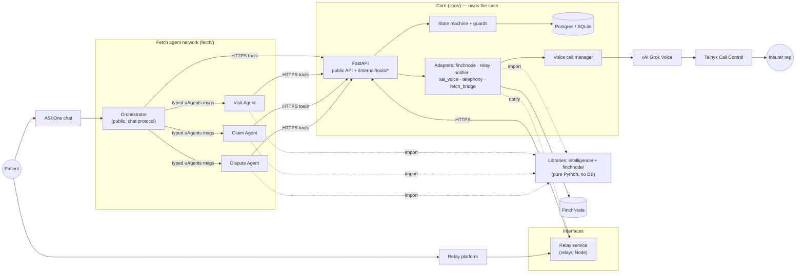
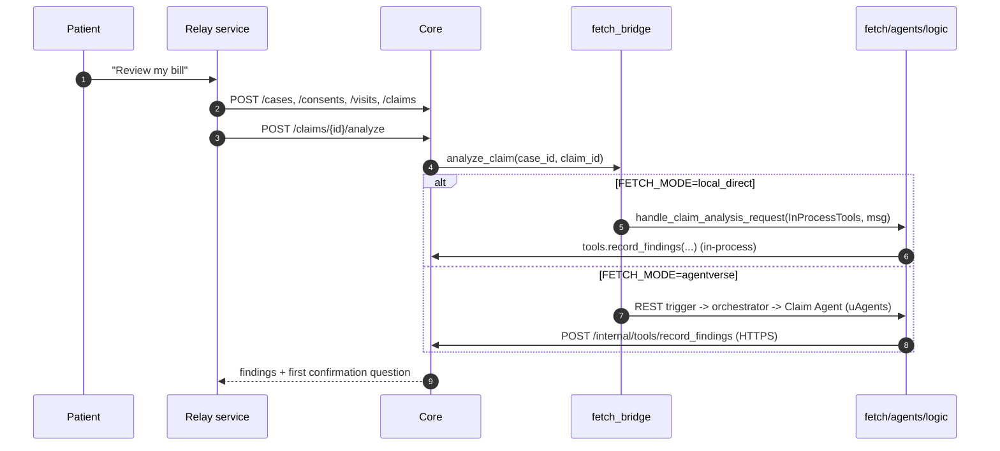
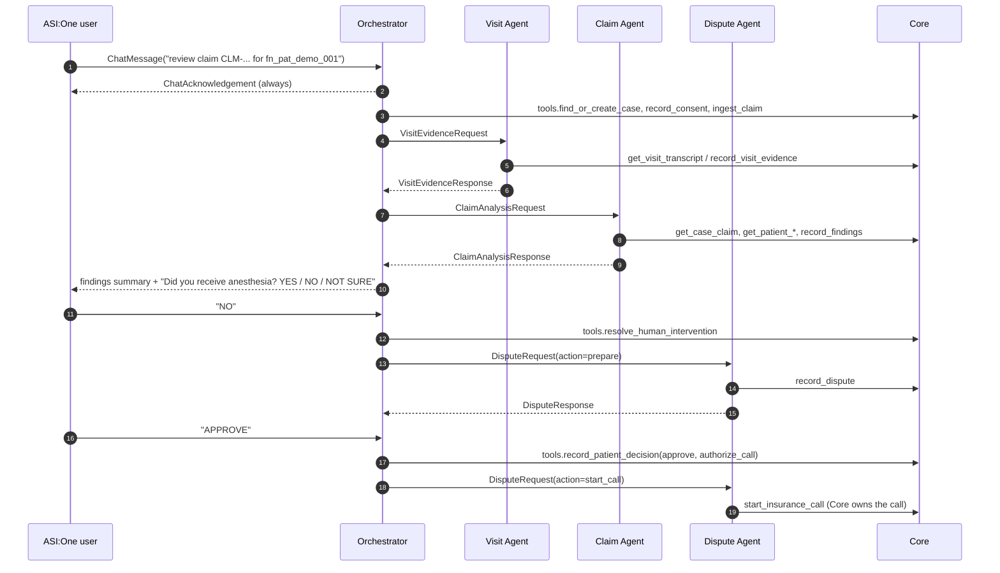
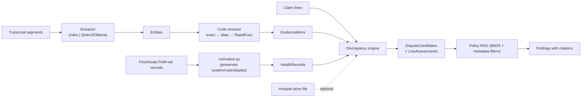

# Amyna Architecture

> Hackathon prototype. All demo data is synthetic. Not HIPAA-production-ready.

## 1. System context

## 2. Non-negotiable rules

1. **Relay and ASI:One are interfaces. Fetch is the agent network. FinchNode is the health-data source. Core owns the case** — it is the single source of truth.
2. **Agent ↔ agent** traffic uses Fetch uAgents typed messages (`shared/python/claimshield_contracts/agent_messages.py`). **Agent ↔ application** traffic uses plain HTTPS calls to Core's internal API (`/internal/tools/*`). Fetch agents never touch the database.
3. **Relay never calls FinchNode or Fetch directly** (Relay → Core → others). Fetch agents never call FinchNode directly; they use Core tool endpoints, so consent checks, logging, retries and normalization live in one place.
4. **Agentverse is for registration, discovery, mailbox and ASI:One routing only.** Agent code runs locally (`mailbox=True`), not on Agentverse.
5. **No fine-tuning, no "train on all laws/codes".** The pipeline is: small local model for narrow extraction (Qwen3 via Ollama, or a deterministic rules fallback) → deterministic code resolver → versioned policy RAG → reasoning agent. Codes already present in FinchNode source records are preferred over re-deriving them.
6. **Agents exchange structured, typed outputs** (Pydantic / uAgents `Model`), never blobs of prose. Chat text is rendered from typed data at the edge.
7. **Safety gates are enforced in code**, not only in prompts:
   - no call without an APPROVED dispute **and** a stored `patient_authorization_id` (`core/app/state_machine.py`);
   - SSN / PIN / password / auth-code / DOB-verification requests trigger `request_human` and pause the call (`core/app/services/security_policy.py`, run on every insurer utterance);
   - the voice agent cannot state billing codes or medical facts that are not in the case evidence (`check_agent_utterance`).
8. **Every external system sits behind an adapter** with `mock` and `live` implementations selected by an env var. Mock mode is realistic enough to demo.
9. **Unverified sponsor API details are isolated in adapters** and tagged `# VERIFY against current docs`; the full list is in [VERIFY_LIST.md](VERIFY_LIST.md).

## 3. Components

| Area | Path | Owner | Notes |
|---|---|---|---|
| Contracts | `shared/` | Member 1 | Pydantic v2 domain models, HTTP schemas, uAgents messages, generated OpenAPI + TS types |
| Core API | `core/app/` | Member 1 | FastAPI, SQLAlchemy 2, Alembic, state machine, auth, audit, adapters, voice manager |
| Relay service | `relay/` | Member 2 | Node/TypeScript webhook server; talks only to Core |
| Agents | `fetch/agents/` | Member 3 | uAgents wrappers (thin) + `logic/` (pure functions) + `local_direct.py` |
| FinchNode | `finchnode/` | Member 4 | Client (mock / demo / sandbox), FHIR-ish normalization that preserves source codes |
| Intelligence | `intelligence/` | Member 4 | Extraction, code resolver, hospital price ingest, policy RAG, discrepancy engine |

### 3.1 Two ways a case moves forward

### 3.2 Voice call ownership

The Dispute Agent only *requests* a call (`start_insurance_call`). Core's
`VoiceCallManager` (`core/app/services/voice_service.py`) owns the long-running
session through the `xai_voice` and `telephony` adapters. Phone audio never
flows through a uAgent. Every insurer utterance passes through
`security_policy.detect_sensitive_request`; a hit creates a `HumanIntervention`,
moves the case to `HUMAN_REQUIRED`, pauses the session and notifies the patient
through the Relay notifier. Resolving the intervention resumes the call.

## 4. Data flow and evidence

## 5. Ports

| Service | Port |
|---|---|
| Core | 8080 |
| Relay service | 3000 |
| Orchestrator agent | 8000 |
| Visit / Claim / Dispute agents | 8001 / 8002 / 8003 |
| Postgres | 5432 |
| Ollama | 11434 |

## 6. Decisions

Decisions made while building the scaffold. Change them through a PR to `main`.

| # | Decision | Why |
|---|---|---|
| D1 | **uAgents messages use a `pydantic.v1` base.** `agent_messages.py` subclasses `uagents.Model` when uagents is installed, otherwise an equivalent shim on `pydantic.v1.BaseModel`. Message DTOs only nest other message DTOs; converters map to/from the Pydantic v2 domain models. | `uagents==0.25.5`'s `Model` is built on `pydantic.v1.BaseModel` (verified by inspecting the installed package), so v2 models cannot be nested inside messages. The shim keeps schema digests identical with or without uagents (verified against the real package; note that pydantic.v1 puts class docstrings into the schema, so docstrings are part of the digest). Digests are pinned in `fixtures/agent_message_digests.json` and checked by a test. |
| D2 | **Message fields that carry enums are typed `str`.** | Adding an enum value would otherwise change the schema digest and break running agents. Values are validated when converted to domain models. |
| D3 | **Money is integer cents; IDs are prefixed strings** (`case_…`, `fnd_…`). | No float rounding; readable logs and demos. |
| D4 | **One implementation of agent logic.** `fetch/agents/logic/*` are pure functions taking a `CoreTools` protocol. uAgents wrappers, `local_direct.py`, and Core's `fetch_bridge` (mock) all call the same functions. In `FETCH_MODE=local_direct`, Core runs them in-process with `InProcessTools` (same tool service, same audit log, one transaction per tool call — mirrors HTTP semantics). | The Relay path and the ASI:One path must produce identical findings, and the demo must work with no Agentverse. |
| D5 | **Visit evidence is gathered before claim analysis.** The orchestrator sends `VisitEvidenceRequest`, then `ClaimAnalysisRequest` once evidence is recorded (both correlated by `request_id` + `case_id`). | The comparison needs visit evidence; doing both concurrently races. |
| D6 | **Patient confirmation questions are `HumanIntervention`s** (`reason=patient_confirmation`) sent **one at a time** with YES / NO / NOT SURE buttons. Answers map to finding statuses through each finding's `confirmation.effects`. | One clean question per message; one resolution path (`POST /human-intervention/{id}/resolve` or the signed Relay webhook) for every kind of human input. |
| D7 | **`patient_authorization_id` is the id of the approval `HumanDecision`** (with `authorize_call=true` and the exact authorization text the patient saw). | Durable, auditable proof of authorization; the state-machine guard checks it before `CALL_IN_PROGRESS`. |
| D8 | **Seed scenario yields 3 findings; 2 need the patient.** Anesthesia ($780, unsupported, confidence 0.85) asks the headline question "Did you receive anesthesia…? YES / NO / NOT SURE". The unclassified drug ($40, confidence 0.55) asks whether any medication other than lorazepam was given. The duplicate facility fee ($250, 0.97) is auto-confirmed. | The spec requires both the clean anesthesia question and "unknown medication → ask patient". Only patient-answerable issue types ever ask the patient. |
| D9 | **Core → patient notifications go through a notifier adapter** (`NOTIFY_MODE=outbox` stores them in DB; `relay_service` also POSTs them to the Relay service). Patient replies come back as signed events on `POST /relay/webhook` (HMAC-SHA256 over `timestamp.body`, idempotent by `event_id`) or through the explicit REST endpoints. | All Relay SDK usage stays in Member 2's Node service; Core never depends on Relay's API shape. |
| D10 | **Separate secrets per direction.** `RELAY_WEBHOOK_SECRET` verifies Relay-platform → Relay-service webhooks (sponsor-issued); `CORE_WEBHOOK_SECRET` signs Relay-service → Core events. | Different trust boundaries; rotating one does not break the other. |
| D11 | **Mock voice calls run synchronously and deterministically**; the live adapter runs the realtime WebSocket loop on a background thread with its own DB sessions. Mock call cursor state lives in process memory (single Core worker). | Deterministic tests/smoke; realistic structure for live. |
| D12 | **Dial allowlist.** Core only dials numbers in `TELEPHONY_ALLOWED_NUMBERS`, in every mode. | A demo must never accidentally call a real insurer. |
| D13 | **The voice model never chooses the case.** The tool-call dispatcher injects `case_id`/`call_id`; the model only supplies tool-specific arguments. | Prevents cross-case data access through prompt injection on the call. |
| D14 | **Human resolution notes are scanned for sensitive data** and rejected (422) if they contain an SSN-like value, PIN, or password. | Amyna must never store the secrets it refuses to say. |
| D15 | **Live-call guardrails are post-hoc for audio.** In realtime voice, audio is generated with its transcript, so `check_agent_utterance` runs on transcript events and interrupts/pauses on violation; prevention relies on tool-gated facts + the system prompt. | Honest limitation of realtime audio; documented in SECURITY.md. |
| D16 | **SQLite fallback everywhere except docker-compose.** `DATABASE_URL` empty → `.data/amyna.db`. Tests use temp-file SQLite. | Zero-dependency local dev and CI. |
| D17 | **Packaging.** `shared/python` → `claimshield-contracts`; repo-root `pyproject.toml` → `claimshield-libs` (`intelligence`, `finchnode`, `fetch`); `core/` → `claimshield-core` (package `app`). One `.venv` holds everything (uagents' pins are compatible with FastAPI's stack). | Plain imports everywhere, no `PYTHONPATH` hacks. |
| D18 | **Case lookup for chat users is per claim.** `find_or_create_case(patient, claim number)` reuses an open case tagged with that claim or already holding it. Otherwise it adopts an open case with no claim yet (e.g. a recorded visit waiting for its bill), or creates a case. A case holding a different claim is never reused. Patient demographics are enriched from FinchNode only after `health_data_access` consent. | ASI:One users don't know case ids; two bills must never share findings or a dispute; no health data is read before consent. |
| D19 | **Idempotent agent work.** Visit logic returns existing evidence, claim logic returns existing findings, dispute logic returns the existing dispute. `POST /claims/{id}/analyze` on an analyzed claim returns the stored analysis. | Both interfaces can trigger the same step without double-processing. |
| D20 | **Policy citations are attached by the Claim Agent**, not the engine. The engine stays pure and deterministic; `intelligence.policy_rag.retrieve.cite_findings` adds citations filtered by state, payer and issue type. | Testable engine; RAG can evolve independently. |
| D21 | **Relay UX is driven by Core's notifications.** Core's outbox is the single source of patient prompts. The Relay service renders each notification exactly once, whether Core pushes it (`/internal/notify`) or the service pulls the outbox (mock), and forwards button replies as signed events. The service originates only consent, recording, "review my bill", dispute preparation and call start. | One-question-at-a-time and approval/handoff cards behave identically in mock and live; there are no duplicate prompts and no copy of Core's decision logic in Node. |
| D22 | **Contracts import `Model` from `uagents_core.models`**, not `uagents`. | Same class, but importing `uagents` configures root logging as a side effect, which would duplicate Core's JSON logs. |
| D23 | **Offline uAgents runs** point Agentverse at a closed local port (`OFFLINE_AGENTVERSE`), and tests also stub the startup status update. A Bureau gets its own thread and event loop in tests. | uAgents retries the Agentverse status call with backoff before startup handlers run, and a Bureau cancels every task on its loop at shutdown (which deadlocks a test awaiting it). Every `Agent` also registers in a process-global dispatcher and never unregisters, so tests unregister their agents after each Bureau (test seeds repeat, and a stale agent with the same address would answer). Verified in the installed source. |
| D24 | **TS types are generated with `--default-non-nullable=false`.** | Defaulted request fields stay optional in TypeScript instead of being forced on callers. |
| D25 | **Claim selection by claim number.** Relay and ASI:One users name the claim (`CLM-…`); Core pulls it from FinchNode after consent. | No list-claims endpoint is needed in the public API, and nothing is read before consent. |
| D26 | **Shared demo driver.** `core/app/demo_support.py::run_demo_flow` drives the scenario through the public API; the smoke script runs it over real HTTP (uvicorn + Alembic), and a pytest runs it via TestClient. The seed uses the same helpers in-process. | One definition of the expected flow, exercised three ways. |
| D27 | **Letter-only approval resolves the case.** Approving with `authorize_call=false` records the approval with no `patient_authorization_id` and moves `APPROVED → RESOLVED` (the patient sends the letter). | No case ever waits in APPROVED for a call nobody authorized; the call guard stays as defense in depth. |
| D28 | **Optimistic locking on cases** (`cases.version`, SQLAlchemy `version_id_col`) plus unique visit / claim / dispute per case. Losing writers get 409 `concurrent_update`; constraint violations get 409 `conflict` (no SQL echoed; the engine hides parameters). | Double taps and racing interfaces (Relay + ASI:One + webhooks) cannot start two calls or advance a state twice. Cheap, and works on SQLite and Postgres. |
| D29 | **Consents are append-only; the latest decision per type wins**, and a revocation wins a timestamp tie. | Revocation must be honoured immediately and auditable; fail safe. |
| D30 | **Safety commands are exact-match in chat.** APPROVE / REJECT / DONE / CANCEL count only as the whole message; anything that mentions them otherwise ("I don't approve") is re-prompted. YES/NO answers with hedges ("yes, but…") are re-asked. | An LLM or loose keyword match must never turn a negation into an insurer call. |
| D31 | **Agent sender checks.** Specialists answer only `ORCHESTRATOR_ADDRESS` (a mailbox specialist without it refuses to start). The orchestrator accepts a reply only from the agent its `request_id` was sent to, and serializes work per chat sender with a lock. | Case data is PHI; Agentverse addresses are public. |
| D32 | **Relay retry semantics.** A conversation stage advances only after its step succeeded. Each step is idempotent: the case, visit and claim ids are saved as soon as Core returns them, and Core treats complete / analyze / prepare as idempotent. Events are serialized per patient. Core 4xx → patient message + 200 to the platform; 5xx / network → 500 and the event id is released for the platform's retry. A notification is marked delivered only after a successful send, with an in-flight guard so push and pull never double-send. | Platform retries must neither duplicate work nor skip a step, and a permanent error must not cause a retry storm. |
| D33 | **Voice failure compensation.** Any failure after the call row is committed (dial, voice-session start, resume) hangs up best-effort, ends the call FAILED, moves the case to FAILED and notifies the patient. A handoff requested on a call with a non-handoff reason is coerced to `call_escalation`. | A case is never stranded in CALL_IN_PROGRESS; pausing is always the safe default. |
